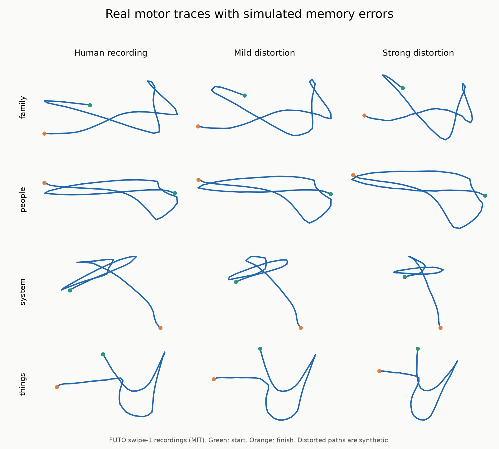

# Draw Swipe Predictor

Draw the motion of swipe typing from memory and get word suggestions. The drawing can move, stretch, rotate, or miss parts of the ideal keyboard route.

The project now includes a learned route recognizer trained on real human swipe recordings and distorted drawings. Its native Rust runtime uses a small convolutional encoder and cached word vectors. The original DTW and CTC experiments remain available for comparison.

## Measured improvement

The latest version adds independent shape retrieval and a learned candidate reranker. On a new test with 879 real recordings from 107 previously unseen donor sessions and 6,000 synthetic drawings, using 60,000 candidate words:

| Input | Previous learned: first choice | New: first choice | New: top five |
|---|---:|---:|---:|
| Real swipe | 82.3% | 83.6% | 94.1% |
| Distorted real swipe | 71.3% | 73.0% | 88.9% |
| Clean synthetic | 96.5% | 96.5% | 99.8% |
| Loose synthetic | 66.9% | 70.5% | 84.2% |
| Hard synthetic memory | 33.9% | 42.8% | 62.2% |

Median native inference takes 6.9 ms on the M4 Max, compared with 3.5 ms for the previous learned version. The hard-memory gain is 8.95 percentage points, with a paired 95% interval of 7.5–10.35 points. The recordings use visible keyboards; distorted and synthetic tests do not establish accuracy for human freehand memory gestures.

On the earlier 10,000-word synthetic test, hard-memory accuracy improves from 52.3% to 57.3%, while clean accuracy stays at 99.0%. The first learned model already improved substantially over the original DTW recognizer. See [the benchmark report](benchmarks/README.md) for paired results, timing, and limits.

## Run the app

Install Rust, then run:

```sh
cargo run --release
```

Draw a word anywhere in the window, then release the mouse to get suggestions. Press Up or Down to inspect alternatives, Space to clear the drawing, and H to show or hide a keyboard reference. The memory app starts with the reference hidden.

To build a double-clickable macOS app:

```sh
python3 scripts/build_memory_app.py
```

The app is written to `build/Draw from Memory.app`.

## How recognition works

The learned recognizer compares an input gesture with word routes in a learned vector space. Training teaches it which changes in a route should preserve its identity. It uses real recordings together with augmented routes that contain rotated or stretched keyboards, misplaced turns, endpoint errors, and drift. Hard-negative mining adds words with confusingly similar routes to the training comparisons.

At export time, the model combines canonical routes with consensus vectors from real training drawings. Validation selects the combination, the word-frequency prior, and any orientation ensemble. Recognition uses one encoder pass per orientation and a scan of cached word vectors. It then combines 32 neural candidates with 32 additional candidates found directly from shape. A small network compares elastic alignment, endpoints, rounding, rotation, and route complexity. Clear neural matches keep their original ranking to protect clean gestures. Python and GPU libraries are only needed for training.

The geometry recognizer offers a separate option without neural weights. It caches sharp and rounded word templates, searches several orientations, and normalizes axis stretch. A shortlist receives elastic alignment that scores positions and directions under the same correspondence. Its ranking weights come from automatic fitting on synthetic examples.

```sh
# Geometry recognizer
cargo run --release --bin swipe-memory

# Original DTW recognizer
cargo run --release --bin swipe-dtw

# Original CTC recognizer, after training its ONNX model
cargo run --release --features neural --bin swipe-ctc
```

## Real and synthetic data

[FUTO's open swipe corpus](https://huggingface.co/datasets/futo-org/swipe.futo.org) provides real human recordings under the MIT license. The downloader pins the source revision, preserves separate donor sessions across dataset splits, restores physical coordinates, and records hashes. It downloads bounded byte windows and caches them for repeat runs.

The synthetic generator gives each writer a distorted mental keyboard: consistent errors in key positions, shifted rows, a drawing angle, and a rounding style. Individual attempts can omit a waypoint, drift, or start and finish imprecisely. It produces 24,000 labeled drawings by default, with separate target words and writer seeds across its dataset files.

```sh
python3 training/generate_memory_data.py
python3 training/fetch_real_swipes.py \
  --train 150000 --validation 10000 --test 5000 --vocab 30000 \
  --output-dir training/data/futo-large
```



See [the training guide](training/README.md) for the full GPU training, calibration, and export workflow. No manual recording or labeling is required. Generated data and training checkpoints remain local; source manifests and benchmark reports are tracked.

## Test from the command line

```sh
cargo test --workspace --all-targets
uv run --directory training python -m unittest test_retrieval

# Compare all recognizers on identical synthetic gestures.
cargo run --release -p swipe-engine --example memory_bench -- \
  --vocab 10000 --samples 300 --seed 12345 \
  --model crates/swipe-engine/models/retrieval --output /tmp/synthetic-results.json

# Compare recognizers on real recordings and distorted versions of those traces.
cargo run --release -p swipe-engine --example real_bench -- \
  --dataset training/data/futo-large/test.jsonl --samples 1000 --vocab 10000 \
  --model crates/swipe-engine/models/retrieval --output /tmp/real-results.json

# Repeat with the full default vocabulary.
cargo run --release -p swipe-engine --example real_bench -- \
  --dataset training/data/futo-large/test.jsonl --samples 500 --vocab 60000 \
  --model crates/swipe-engine/models/retrieval --output /tmp/default-vocabulary-results.json

# Verify native embeddings against the exported PyTorch reference outputs.
cargo run --release -p swipe-engine --example retrieval_cli -- \
  --model crates/swipe-engine/models/retrieval \
  --verify crates/swipe-engine/models/retrieval/verification.json
```

For JSONL predictions without opening a window, pipe records containing `points: [[x, y], ...]` into `retrieval_cli --model crates/swipe-engine/models/retrieval`.

## Limits

Public human recordings were collected over visible keyboards. Distorting those traces provides a useful transfer test, but does not establish accuracy for freehand gestures drawn entirely from memory. Synthetic results are also separate from human accuracy.

Some word pairs have identical routes after translation, scaling, or repeated-letter collapse. Geometry alone cannot resolve those cases. The recognizer returns alternatives and applies a word-frequency prior; its scores are distances, not calibrated confidence probabilities.

The neural word bank has a fixed exported vocabulary. Export a larger bank to include more words. The encoder can represent new canonical routes without adding a word-classification output layer.

## Project structure

- `crates/swipe-engine/`: geometry recognition, native neural inference, and CLI benchmarks.
- `apps/desktop/`: drawing interface and recognizer backends.
- `training/`: real-data import, synthetic data generation, training, and model export.
- `benchmarks/`: reproducible reports and dataset provenance.
